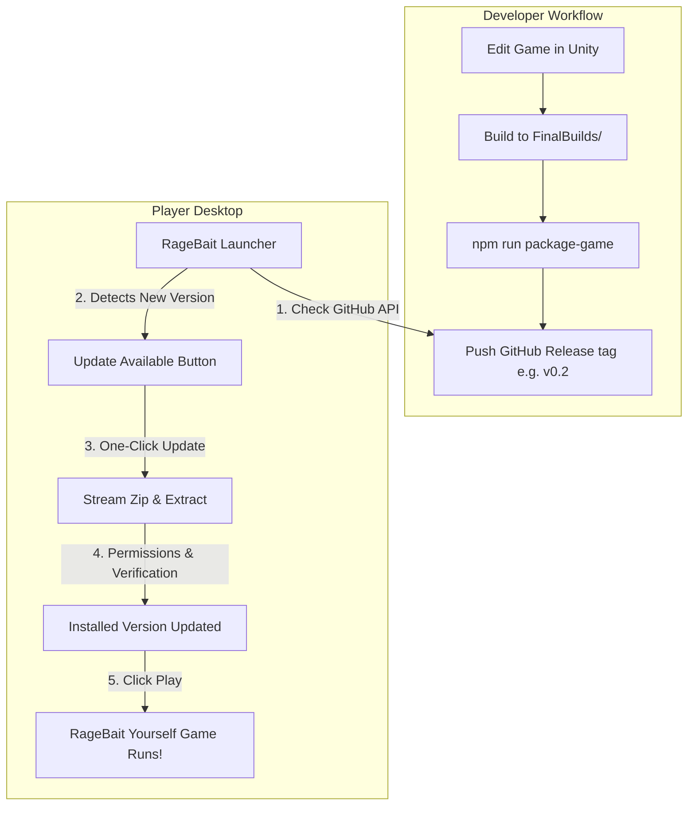

# 🚀 RageBait Yourself: One-Time Installer & Auto-Updater System

A complete cross-platform **Game Launcher & Auto-Updater** for **RageBait Yourself** (supporting **macOS**, **Windows**, and **Linux**).

Players install the launcher **once**. Whenever you make updates, bug fixes, or new levels in the future, the launcher automatically detects the new release on GitHub, downloads the update with progress tracking, unpacks it safely, and launches the game seamlessly.

---

## 🏗️ Architecture



---

## ⚡ 1. How to Test the Launcher Right Now (Locally)

You don't even need to publish to GitHub first to test it. We built in offline local-build support so you can test it on your Mac immediately:

1. Open your terminal in the `Launcher` folder:
   ```bash
   cd Launcher
   npm start
   ```
2. The launcher UI will open.
3. If no release is online yet, you will see **"INSTALL LOCAL BUILD"**. Click it!
   - It copies the local `FinalBuilds/RageBaitYourself-0.1-macos-universal.app` into your game directory.
   - It sets up executable permissions and clears macOS gatekeeper attributes.
4. The button turns green: **"PLAY GAME"**!
5. Click **"PLAY GAME"** to launch `RageBait Yourself`!

---

## 📦 2. How to Build the One-Time Installers (For Players)

When you are ready to distribute your game to players, generate the native one-time installer:

In `Launcher/`:

| Target OS | Command | Output Artifact in `Launcher/dist/` |
| :--- | :--- | :--- |
| **macOS** | `npm run dist:mac` | `RageBait Launcher-1.0.0.dmg` (or `.zip`) |
| **Windows** | `npm run dist:win` | `RageBait Launcher Setup 1.0.0.exe` (NSIS Installer) |
| **Linux** | `npm run dist:linux` | `RageBait Launcher-1.0.0.AppImage` |

> [!TIP]
> You share this single installer with your players (on your website, itch.io, Discord, or Google Drive). They install it once, and they **never need to download an installer again**.

---

## 🔄 3. How to Release Future Game Updates (Step-by-Step)

Whenever you change code, fix bugs, or add new levels in Unity:

### Step 1: Export builds from Unity to `FinalBuilds/`
Export your updated builds into `FinalBuilds/` just like your existing builds:
- `FinalBuilds/RageBaitYourself-0.1-macos-universal.app`
- `FinalBuilds/RageBaitYourself-0.1-win-x64`
- `FinalBuilds/RageBaitYourself-0.1-linux-x86_64`

### Step 2: Package the updates
Run this single command inside `Launcher/`:
```bash
npm run package-game
```
This automatically compresses the builds into:
- `Launcher/dist-game-releases/RageBaitYourself-macos.zip`
- `Launcher/dist-game-releases/RageBaitYourself-win-x64.zip`
- `Launcher/dist-game-releases/RageBaitYourself-linux-x86_64.zip`

### Step 3: Create a GitHub Release
1. Go to your GitHub repository (e.g. `https://github.com/your-username/RageBaitYourself/releases`).
2. Click **"Draft a new release"**.
3. Set a tag (e.g. `v0.2.0`).
4. Type your release title and patch notes (e.g. *"Added Level 7, Fixed Jump Physics"*).
5. Drag and drop the 3 zip files from `Launcher/dist-game-releases/` into the assets box.
6. Click **"Publish release"**.

### That's it!
Every player who opens **RageBait Launcher** will automatically:
1. See the new patch notes.
2. See the glowing button **"UPDATE TO v0.2.0"**.
3. Click it to download and install the update in seconds.
4. Click **"PLAY GAME"**!

---

## ⚙️ 4. Setting Your GitHub Repository

Inside `Launcher/main.js` (line 25), change `githubOwner` and `githubRepo` to your GitHub username and repo:

```js
const defaultConfig = {
  githubOwner: 'your-github-username',
  githubRepo: 'RageBaitYourself',
  // ...
};
```

You can also change this directly at runtime in the **Launcher UI > Settings tab**.

---

## 🤖 5. Automated CI/CD (GitHub Actions)

A workflow file has been added at:
[release-game.yml](file:///Users/anupamkanoongo/RageBaitYourself/.github/workflows/release-game.yml)

Whenever you push a tag to GitHub:
```bash
git tag v0.2.0
git push origin v0.2.0
```
GitHub Actions will automatically package the game and attach the multiplatform release zips to the GitHub Release!
